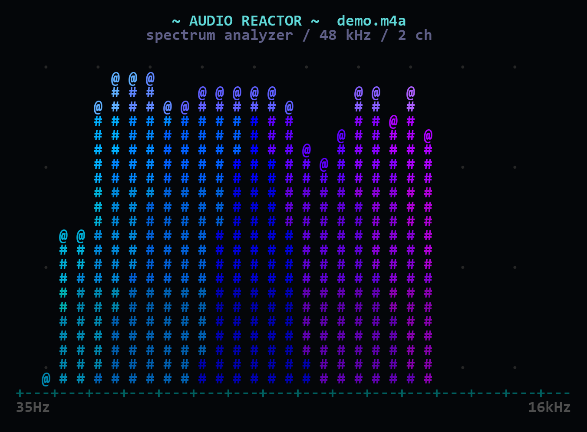

# ASCII Player

把视频/音频变成终端里的**彩色 ASCII 动画**：每个字符的浓淡由画面亮度决定，颜色来自原画面像素。用 C++17 编写，直接输出 ANSI 彩色字符。Windows 使用 `waveOut` 同步播放，Linux / WSL 使用系统里的命令行音频播放器或自动静音。默认 256 色兼顾流畅度，`--color truecolor` 可开启 24-bit 真彩色。

支持 **Windows 10/11** 和 **Linux x86_64**（包括 WSL2）。




> 预览图使用经典 ` .:-=+*#%@` 字符梯度；默认字符集包含更多符号、数字和大小写字母。

## 快速开始

### Windows

直接运行 exe，把媒体文件拖进窗口或输入路径：

```powershell
dist\ASCIIPlayer.exe
```

也可以从命令行启动：

```powershell
dist\ASCIIPlayer.exe samples\demo.mp4
dist\ASCIIPlayer.exe samples\demo.m4a
dist\ASCIIPlayer.exe samples\demo.mp4 --width 120 --chars " .:-=+*#%@"
```

`dist\` 目录里已经带上 `ffmpeg.exe`，复制整个目录即可在另一台 Windows 电脑上运行。

### Linux / WSL

先装 `ffmpeg`；想要声音再装 PulseAudio/PipeWire/ALSA 的播放命令之一：

```bash
sudo apt update
sudo apt install -y ffmpeg pulseaudio-utils
```

WSL2 的 WSLg 已经提供 PulseAudio 服务，`PULSE_SERVER` 通常会自动指向 `/mnt/wslg/PulseServer`。

#### Termux / Android

Termux 里可以装 `clang` 和 `ffmpeg`，然后从源码编译；不要用 `STATIC=1`，Android 的 bionic 不支持 glibc 静态链接：

```bash
pkg update
pkg install clang ffmpeg
git clone https://github.com/qwaszxopklnmso/ASCII_Player.git
cd ASCII_Player
./build-linux.sh
./build-linux/ascii-player samples/demo.mp4
```

Termux 没有 `paplay` 时通常会自动静音；需要声音可以装带 `ffplay` 的 FFmpeg 包，或使用 Termux 的音频播放工具。

下载 Release 里的 `ASCIIPlayer-linux-x86_64.tar.gz`，解压后运行：

```bash
tar -xzf ASCIIPlayer-linux-x86_64.tar.gz
cd ASCIIPlayer-linux-x86_64
./ascii-player samples/demo.mp4
./ascii-player samples/demo.m4a
```

也可以从源码编译：

```bash
./build-linux.sh
./build-linux/ascii-player samples/demo.mp4
```

播放中按 `Q` / `Esc` 退出，`Ctrl+C` 也可以。Linux 版是静态链接的 x86_64 可执行文件，不依赖本机 glibc 版本；FFmpeg 需要系统安装或放在程序旁边。

## 功能

- **MP4 / M4A / M4S**：以及 FFmpeg 能解码的其它格式。
- **亮度 → 字符**：默认字符梯度包含符号、数字、大小写字母（约 95 个字符），全部按疏密排列；可用 `--chars` 换成任意由疏到密的可打印 ASCII。
- **彩色**：默认 ANSI 256 色；`--color truecolor` 开启 24-bit 前景色，`mono` 关闭颜色。
- **终端自适应**：按当前终端大小和视频宽高比计算字符网格。
- **音画同步**：音频解码成 48 kHz 双声道 PCM；Windows 用 `waveOut` 流式播放，Linux 交给 `paplay` / `pw-play` / `aplay` / `ffplay` / `mpv` 播放，画面以音频位置或高精度墙钟为时钟。
- **纯音频可视化**：M4A 等没有视频的输入会显示实时 FFT 频谱。
- **JSON 场景**：可把视频/频谱导出成自包含 JSON，再在终端参数里离线回放，不再需要原视频。
- **M4S / DASH**：支持带 initialization segment 的 fMP4 分片，也支持视频、音频分片分开传。
- **自动找音轨**：视频没有音轨时，会在同目录寻找匹配的音频；支持 Bilibili 单独下载的 `30280.m4s`。
- **Bilibili 文件头修复**：B 站缓存的视频/音频 `.m4s` 开头常有额外字节（通常是 9 个 ASCII `0`），程序会自动跳过并解码，不需要先手工转成 `.m4v`。
- **自动用 Windows Terminal（仅 Windows）**：从传统 conhost 启动时自动在 Windows Terminal 中重开，获得更好的全屏性能；`--no-wt` 可关闭自动切换。
- **性能保护**：画面跟不上音频时自动丢帧，不会越播越滞后；默认限制 300 列，`--full` 使用终端全部行列。
- **拖放播放（仅 Windows）**：把视频拖到 `ASCIIPlayer.exe` 上即可。

## 常用命令

下面以 Windows 的 `ASCIIPlayer.exe` 为例；Linux / WSL 把命令名换成 `./ascii-player`，路径分隔符换成 `/`。

```powershell
# 指定宽度（高度自动按画面比例算）
ASCIIPlayer.exe movie.mp4 --width 100

# 自定义字符梯度（从疏到密）
ASCIIPlayer.exe movie.mp4 --chars " .#%@" --color truecolor

# 纯音频频谱
ASCIIPlayer.exe music.m4a

# 单独音轨（视频 m4s + 另一个 m4a，或 DASH 音视频分片）
ASCIIPlayer.exe video.m4s --init init-video.mp4 --audio audio.m4a
ASCIIPlayer.exe video.m4s --init init-video.mp4 --audio audio.m4s --audio-init init-audio.mp4

# 截取 2:10 开始的 30 秒
ASCIIPlayer.exe movie.mp4 --start 2:10 --duration 30

# 关闭声音，只保留画面
ASCIIPlayer.exe movie.mp4 --no-audio

# 循环
ASCIIPlayer.exe movie.mp4 --loop
```

仓库里带了测试素材：

```powershell
dist\ASCIIPlayer.exe samples\demo.mp4 --width 100
dist\ASCIIPlayer.exe samples\demo.m4a
dist\ASCIIPlayer.exe samples\dash\video.m4s --init samples\dash\init-video.mp4 `
    --audio samples\dash\audio.m4s --audio-init samples\dash\init-audio.mp4
```

Linux / WSL 里把命令名换掉即可：

```bash
./ascii-player samples/demo.mp4 --width 100
./ascii-player samples/demo.m4a
./ascii-player samples/dash/video.m4s --init samples/dash/init-video.mp4 \
    --audio samples/dash/audio.m4s --audio-init samples/dash/init-audio.mp4
```

Bilibili 下载目录里常见的 `Video.m4v` + `30280.m4s` 组合不需要手动指定：

```powershell
dist\ASCIIPlayer.exe "D:\Videos\bilibili\1190003800\[False Alarm]大雨还在下Video.m4v"
```

程序会自己发现同目录的 `...30280.m4s` 并作为音轨播放。

B 站缓存的视频分片也可以直接播放，不需要先改名或去掉文件头：

```powershell
dist\ASCIIPlayer.exe "D:\Videos\bilibili\1190003800\1190003800_nb3-1-30080.m4s"
```

如果分片开头有多余的 `0` 字节，启动时会提示跳过了多少字节，然后自动修复并播放。

## JSON 场景

### 导出

```powershell
ASCIIPlayer.exe movie.mp4 --export-json movie.json --width 100 --fps 24
ASCIIPlayer.exe music.m4a --export-json spectrum.json --width 96 --fps 15
```

导出内容包含每一帧的字符和 xterm-256 颜色索引，是**自包含**的，默认静音；回放时可以额外指定音轨同步播放。文件大小约为：

```
宽度 × 高度 × 3 字节 × 帧率 × 秒数
```

例如 100×28、24 fps、10 秒约 2 MB。长时间视频请先用 `--duration` 截取，或降低 `--width` / `--fps`。

### 回放

```powershell
ASCIIPlayer.exe --play-json movie.json
ASCIIPlayer.exe --play-json movie.json --color mono

# 额外配上声音（音轨时间从 0 开始，和场景帧对齐）
ASCIIPlayer.exe --play-json movie.json --audio movie.mp4
```

JSON 的原始尺寸比终端大时，播放器会自动按块做亮度/颜色降采样；比终端小时居中显示。

JSON 结构是公开的，见文件头部：

```json
{
  "format": "ascii-player-scene",
  "version": 1,
  "width": 64,
  "height": 18,
  "fps": 12.0,
  "duration": 2.0,
  "charset": " .:-=+*#%@",
  "colorMode": "ansi256",
  "frames": [
    {"t": 0.0, "c": ["..."], "p": ["3434..."]}
  ]
}
```

`c` 是每一行的字符，`p` 是每格两位十六进制的 xterm 颜色索引。

上面的 `charset` 只是经典 10 字符示例；默认导出会写入完整的约 95 字符梯度。想恢复这种简洁画面：

```powershell
ASCIIPlayer.exe movie.mp4 --chars " .:-=+*#%@"
```

## 选项

| 选项 | 含义 |
| --- | --- |
| `--width N` | 字符列数；默认适配终端 |
| `--height N` | 字符行数；默认按宽高比计算 |
| `--chars " .#%@"` | 自定义从疏到密的字符表；默认约 95 个字符 |
| `--fps N` | 播放/导出帧率，默认源帧率，上限 30 |
| `--color truecolor\|ansi256\|mono` | 颜色模式，默认 `ansi256` |
| `--gamma N` | 亮度伽马，默认 0.85，越小整体越亮 |
| `--gain N` | RGB 颜色增益，默认 1.0 |
| `--invert` | 明暗反转 |
| `--no-audio` | 不播放声音；M4A 仍会绘制频谱 |
| `--start SEC` | 开始时间，支持 `1:23.5` |
| `--duration SEC` | 播放/导出时长 |
| `--loop` | 循环播放 |
| `--init PATH` | 主输入 `.m4s` 的初始化分片 |
| `--audio PATH` | 使用单独音轨；JSON 回放可配同步音频 |
| `--audio-init PATH` | 单独音轨 `.m4s` 的初始化分片 |
| `--export-json PATH` | 导出 JSON 场景后退出 |
| `--play-json PATH` | 回放 JSON 场景 |
| `--plain` | 无颜色、无光标控制，方便重定向 |
| `--no-alt-screen` | 不使用备用屏幕 |
| `--stats` | 打印帧数和实际帧率 |
| `--max-frames N` | 只渲染 N 帧，调试/截图用 |
| `--full` | 使用终端全部行列；默认限制在 300 列以内 |
| `--no-wt` | 不自动切换到 Windows Terminal（仅 Windows） |
| `--stats` | 显示实际帧率、丢帧数和绘制耗时 |

## 全屏、300×84 和性能

状态栏里的 `300x84` 是**字符网格**，不是视频分辨率：全屏像素可能是 2730×1535，但每个字符格只对应一个 ASCII 字符和一个颜色。1920×1080 的 16:9 视频按字符高宽比 2:1 计算，300 列正好得到约 84 行。

- 默认最多 300 列 / 150 行，避免超大网格把终端拖慢。
- 想要用满终端：`--full`；也可以 `--width 400 --height 112`。
- 如果 300×84 仍然卡，优先让程序自动进入 Windows Terminal（默认行为），或者手动：
  ```powershell
  ASCIIPlayer.exe movie.mp4 --width 160 --fps 24 --color ansi256
  ```
- 状态栏右侧显示最近约 1 秒的**实际**渲染帧率，不再是固定写死的目标值。
- `--stats` 会输出实际帧率、丢帧数和每帧绘制耗时，方便判断是解码慢还是终端绘制慢。
- 终端绘制是主要瓶颈：25,000 个彩色字符/帧、30 fps，相当于每秒约 15 MB 的 ANSI 转义序列。传统 conhost 的软件渲染会很慢，Windows Terminal 的 GPU 渲染明显更快。
- Linux / WSL 下同样优先用 GPU 加速的终端（Windows Terminal 的 WSL 标签页、WezTerm、Kitty 等），不要用无加速的串口/远程终端跑 300 列。

## M4S 说明

`m4s` 有两种常见情况：

1. **单个 fMP4 文件**（自身带 `moov`/初始化信息）：直接传入即可。B 站缓存的视频/音频分片属于这一类，即使开头带 9 个 `0` 字节也能自动处理。
2. **DASH 切片**（只有 `moof` + `mdat`）：必须搭配初始分片，否则任何播放器都无法单独解码。

DASH 示例：

```powershell
ASCIIPlayer.exe video.m4s --init init-video.mp4 --audio audio.m4s --audio-init init-audio.mp4
```

`--audio` 也可以直接接一个普通的 `m4a`/`mp4` 文件。没有给 `--init`、且文件缺少完整的 MP4 头时，程序会提示需要初始化分片；B 站那种仅在 `ftyp` 前多几个 `0` 字节的分片会自动修复。

## 构建

### Windows

需要 Visual Studio 的 C++ 桌面工具链（MSVC x64）。在仓库根目录：

```powershell
.\build.bat
```

输出 `build\ASCIIPlayer.exe`。然后打包：

```powershell
.\package.bat
```

`package.bat` 会复制 exe、`ffmpeg.exe` 和许可证到 `dist\`。

### Linux / WSL

只需要 `g++` 或 `clang++`，以及支持 C++17 的标准库。Ubuntu / WSL：

```bash
sudo apt update
sudo apt install -y g++ ffmpeg
./build-linux.sh
```

输出 `build-linux/ascii-player`。要生成不依赖本机 glibc 的静态版本：

```bash
STATIC=1 ./build-linux.sh
file build-linux/ascii-player
# statically linked
```

打包 Linux 发布目录和 tar.gz：

```bash
./package-linux.sh
```

输出 `dist-linux/ASCIIPlayer-linux-x86_64.tar.gz`。

### CMake

Windows：

```powershell
cmake -S . -B build-cmake -A x64
cmake --build build-cmake --config Release
```

Linux：

```bash
cmake -S . -B build-cmake
cmake --build build-cmake -j
```

### 依赖查找顺序

程序本身不需要 FFmpeg 开发库，只调用 FFmpeg 可执行文件。

Windows 查找 `ffmpeg.exe`：

1. `ASCIIPlayer.exe` 同目录
2. 同目录 `bin\` / `tools\`
3. 环境变量 `FFMPEG_PATH`（文件或目录）
4. `PATH`

Linux 查找 `ffmpeg`：

1. 可执行文件同目录
2. 同目录 `bin/` / `tools/`
3. 环境变量 `FFMPEG_PATH`（文件或目录）
4. `PATH`

Linux 音频会依次尝试 `paplay`、`pw-play`、`aplay`、`ffplay`、`mpv`、`play`、`cvlc`。一个都没有时会自动静音，画面仍然正常播放；状态栏会显示 `silent`，结束后打印安装提示。

## 实现原理

1. 用 FFmpeg 读取元数据，把视频解码并缩放成 `宽度 × 高度` 的 RGB24 原始帧，通过匿名管道交给播放器。
2. 每格用 `0.78 × Rec.709 亮度 + 0.22 × RGB 最大值` 计算明度，再经伽马映射到字符梯度。
3. 同一格的原 RGB 作为该字符的前景色，用 ANSI 24-bit 或 xterm-256 输出；颜色相同的连续格只发一次颜色转义。
4. 音频解码为 48 kHz / 16-bit / 双声道 WAV，映射到内存。Windows 由 `waveOut` 以 8 个环形缓冲区流式播放；Linux 把 WAV 交给 `paplay` 等命令播放。
5. 画面帧时钟：Windows 优先用 `waveOutGetPosition`；Linux 用播放器的墙钟位置。音频结束后回退到高精度墙钟；换帧时用 1 ms 定时器对齐。
6. 纯音频模式对当前窗口做 2048 点 FFT，按对数频段和颜色渐变画频谱柱。
7. JSON 导出把字符和量化后的 xterm-256 颜色逐帧写入；JSON 回放用流式解析器，避免一次性把大文件读成 DOM。

## 限制

- Windows 和 Linux x86_64 已支持；macOS 尚未测试。
- Linux 的音频输出依赖系统里的 `paplay` / `pw-play` / `aplay` / `ffplay` / `mpv` 之一。最小化 WSL 发行版默认可能一个都没有；装 `pulseaudio-utils` 即可。
- Linux 的音频时钟是墙钟估算，不像 Windows `waveOutGetPosition` 那样精确；普通播放没有问题，极端情况下可能有几十毫秒偏差。
- 字符的“大小”指的是**字符密度**（`.` 比 `#` 稀疏），不是改变终端字体字号；要改物理大小请调终端字号/窗口大小。
- 终端字符单元通常高约等于两倍宽，默认按 `高 = 宽 × 视频宽高比 × 0.5` 计算；不同字体会略有差异。
- 老式 conhost 会把真彩色近似到 16 色且软件绘制很慢。程序从 conhost 启动时会自动改用 Windows Terminal；也可以用 `--no-wt` 留在 conhost，此时默认 `ansi256`。
- 音频会先完整解码到临时 WAV，超长视频启动会慢一些，也需要临时磁盘空间。`--no-audio` 可以跳过视频的音轨解码。
- 带多余文件头的 `.m4s` 会把去掉文件头后的内容复制到临时文件，大文件启动时会多花一点时间和临时磁盘空间。
- 自动音轨只匹配同目录、同 ID 且时长接近的音频；找不到时才需要手动 `--audio`。
- JSON 本身是静音的视觉快照，不嵌入音频；需要声音时用 `--play-json scene.json --audio media.mp4` 额外指定。
- DASH `.m4s` 必须提供初始化分片；程序不会解析 MPD 自动寻找。
- M4A 的封面图不会被当作视频帧，程序会绘制频谱。

## 目录

```
ASCII_Player/
├─ src/                  C++ 源码
├─ samples/              演示视频、音频、DASH 分片、JSON 场景
├─ docs/                 预览图
├─ tools/preview_json.py 从 JSON 生成 PNG 预览
├─ build.bat             Windows 一键编译
├─ package.bat           Windows 编译并打包 dist
├─ build-linux.sh        Linux / WSL 一键编译（支持 STATIC=1）
├─ package-linux.sh      Linux 编译并打包 dist-linux
└─ CMakeLists.txt
```

## 故障排查

**找不到 ffmpeg / ffmpeg.exe**
Windows：把 `ffmpeg.exe` 放到 `ASCIIPlayer.exe` 旁边，或加到 `PATH`。
Linux / WSL：`sudo apt install ffmpeg`，或设置 `FFMPEG_PATH`。

**颜色不对 / 出现转义字符**
用支持 ANSI 256 色的终端；Windows 推荐 Windows Terminal，Linux 推荐默认终端、Windows Terminal 的 WSL 标签页或 WezTerm。默认是 `ansi256`，需要 24-bit 时加 `--color truecolor`。如果输出被重定向到文件，加 `--plain` 只看字符。

**没有声音**
Windows：检查系统默认播放设备。音频设备不可用时程序会自动回退到静音墙钟，并在结束后打印提示。
Linux / WSL：先确认 `PULSE_SERVER` 有值，再装一个播放命令：

```bash
sudo apt install pulseaudio-utils      # paplay
# 或
sudo apt install pipewire-bin         # pw-play
# 或
sudo apt install ffmpeg               # ffplay
```

也可以用 `aplay`（`alsa-utils`）或 `mpv`。状态栏出现 `silent` 说明当前没有可用的音频后端。Bilibili 的 `Video.m4v` 本身没有音轨，程序会自动找同目录的 `30280.m4s`；找不到就手动加 `--audio "audio.m4a"`。

**很卡 / 30fps 实际只有几帧**
先用 `--stats` 看实际帧率和“draw ms/frame”。如果是绘制慢：
1. Windows 确认在 Windows Terminal 里运行；Linux 用 GPU 加速的终端。
2. 降低字符数：`--width 160 --fps 24`。
3. 用 `--color ansi256` 减少 ANSI 序列体积。
4. 不要盲目加 `--full`；300 列以上会成倍增加终端绘制量。

**M4S 打不开**
先看开头是不是 B 站缓存那种 `000000000` 前缀，程序会自动跳过；如果仍然提示需要初始化分片，它大概率是真正的 DASH 切片，加 `--init init-video.mp4`；音频分片再加 `--audio ... --audio-init ...`。

**临时目录报错 / TEMP 不可写**
视频播放通常不需要临时文件；B 站 `.m4s` 需要修复文件头时，会先写一个临时 MP4。音频解码会依次尝试 `%TEMP%` / `%LOCALAPPDATA%\Temp`（Windows）或 `$TMPDIR` / `/tmp` / 可执行文件目录 / 当前目录（Linux），并在播放结束后删除临时文件。

**画面太暗/太亮**
调 `--gamma`（例如 `--gamma 0.65` 更亮，`--gamma 1.2` 更暗），或 `--gain` 调整颜色。

## 第三方

- FFmpeg：<https://ffmpeg.org/>。Windows 发布包里的 `dist\ffmpeg.exe` 来自 gyan.dev 的 essentials build，按其 GPL 许可证分发；许可证文本见 `dist\FFMPEG_LICENSE.txt`。Linux 发布包不捆绑 FFmpeg，使用系统 `ffmpeg`（apt 安装）。
- 本项目源码使用 MIT 许可证，见 `LICENSE`。
